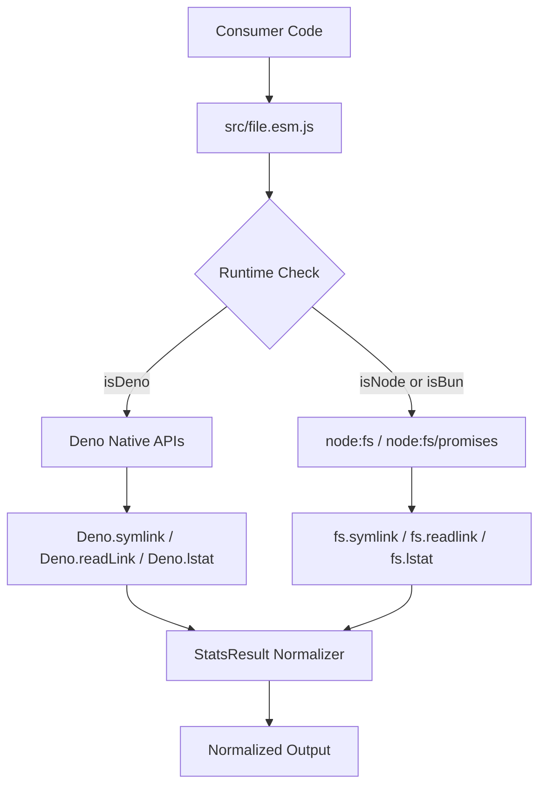

# File Module (`@extcompat/file`) Documentation

The [`@extcompat/file`](src/file.esm.js:1) module provides cross-runtime file system operations with full support for symbolic links across Deno, Node.js, and Bun.

---

## Architecture & Design

### Re-export Model

[`src/file.esm.js`](src/file.esm.js:1) acts as a superset and drop-in replacement for [`@tundralibs/compat/file`](deno.json:5). All foundational file operations (`readFile`, `writeFile`, `makeTempDir`, `remove`, `stat`, etc.) and error classes (`FileNotFound`, `FileAlreadyExists`, `FileAccessDenied`, etc.) are directly re-exported via:

```javascript
export * from '@compat/file';
```

### Dynamic Runtime Engine Routing

Calls are routed dynamically based on environment detection from [`@compat/runtime`](deno.json:6):
- **Deno** (`isDeno`): Utilizes the native global `Deno` APIs (`Deno.symlink`, `Deno.symlinkSync`, `Deno.readLink`, `Deno.readLinkSync`, `Deno.lstat`, `Deno.lstatSync`).
- **Node.js & Bun** (`isNode`, `isBun`): Utilizes `node:fs/promises` and `node:fs` imported dynamically.



---

## Detailed API Specifications

### Functions

#### `symlink(target, path, typeOrOptions?)`
Creates a symbolic link pointing to `target` at destination path `path` asynchronously.
- **Parameters**:
  - `target` (`string | URL`): Destination target path or `file:` URL that the link points to.
  - `path` (`string | URL`): Destination path or `file:` URL where the symlink will be created.
  - `typeOrOptions` (`string | { type?: 'file' | 'dir' | 'junction' }`, optional): Optional type hint.
- **Returns**: `Promise<void>`
- **Errors**:
  - Throws `Error` with message indicating Windows options are unimplemented if Windows type options (`file`, `dir`, `junction`) are provided.
  - Throws error if destination `path` already exists.

#### `symlinkSync(target, path, typeOrOptions?)`
Synchronously creates a symbolic link pointing to `target` at destination path `path`.
- **Parameters**: Same as `symlink`.
- **Returns**: `void`

#### `readlink(path)`
Reads the destination target of a symbolic link asynchronously without following it.
- **Parameters**:
  - `path` (`string | URL`): Path or `file:` URL to the symbolic link.
- **Returns**: `Promise<string>`: Target path stored in the symbolic link.
- **Errors**:
  - Throws error if `path` does not exist or is not a symbolic link.

#### `readlinkSync(path)`
Synchronously reads the destination target of a symbolic link.
- **Parameters**: Same as `readlink`.
- **Returns**: `string`

#### `lstat(path)`
Retrieves metadata for `path` without dereferencing symbolic links (unlike `stat`, which follows symbolic links).
- **Parameters**:
  - `path` (`string | URL`): Path or `file:` URL to inspect.
- **Returns**: `Promise<StatsResult>`: Normalized file status object.
- **Errors**:
  - Throws error if `path` does not exist.

#### `lstatSync(path)`
Synchronously retrieves metadata for `path` without dereferencing symbolic links.
- **Parameters**: Same as `lstat`.
- **Returns**: `StatsResult`

---

## Classes

### `StatsResult`
Normalized cross-runtime file status container wrapping native Deno `FileInfo` or Node `fs.Stats`.

#### Methods
- `isFile()`: `boolean` — Returns `true` if the target is a regular file.
- `isDirectory()`: `boolean` — Returns `true` if the target is a directory.
- `isSymbolicLink()`: `boolean` — Returns `true` if the target is a symbolic link.
- `isSymlink()`: `boolean` — Alias for `isSymbolicLink()`.
- `isBlockDevice()`: `boolean` — Returns `true` if the target is a block device.
- `isCharacterDevice()`: `boolean` — Returns `true` if the target is a character device.
- `isFIFO()`: `boolean` — Returns `true` if the target is a FIFO (named pipe).
- `isSocket()`: `boolean` — Returns `true` if the target is a socket.

#### Properties
- `size`: `number` — Size of the file/symlink in bytes.
- `mtime`: `Date | null` — Last modification timestamp.
- `atime`: `Date | null` — Last access timestamp.
- `birthtime`: `Date | null` — Creation timestamp.
- `ctime`: `Date | null` — Last status change timestamp.
- `mode`: `number | null` — File mode / permission bits.
- `uid`: `number | null` — User ID of owner.
- `gid`: `number | null` — Group ID of owner.
- `dev`: `number | null` — Device identifier.
- `ino`: `number | null` — Inode number.
- `nlink`: `number | null` — Number of hard links.
- `rdev`: `number | null` — Device identifier for special files.
- `blksize`: `number | null` — Block size for filesystem I/O.
- `blocks`: `number | null` — Number of allocated blocks.
