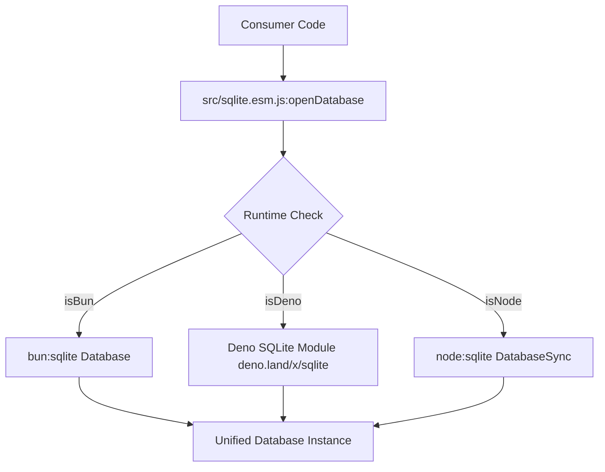

# SQLite Module (`@extcompat/sqlite`) Documentation

The [`@extcompat/sqlite`](src/sqlite.esm.js:1) module provides a unified, cross-runtime SQLite interface across Bun, Deno, Node.js, and derivative runtimes (such as Ende and Dodo).

---

## Architecture & Design

### Cross-Runtime SQLite Engine Routing

[`src/sqlite.esm.js`](src/sqlite.esm.js:1) normalizes native runtime SQLite drivers under a consistent, developer-friendly interface:
- **Bun** (`isBun`): Utilizes native built-in `bun:sqlite` (`Database`).
- **Deno & Derivatives** (`isDeno`): Utilizes pure Deno / Wasm SQLite module (`https://deno.land/x/sqlite/mod.ts`), without requiring `node:` module compatibility.
- **Node.js** (`isNode`): Utilizes built-in `node:sqlite` (`DatabaseSync`).



---

## Installation & Import

### CDN Distribution

```json
{
  "imports": {
    "@compat/sqlite": "https://cdn.jsdelivr.net/gh/bkatzung/extcompat@<semver>/src/sqlite.esm.js"
  }
}
```

---

## Usage Examples

### 1. In-Memory Database & Basic Queries

```javascript
import { openDatabase } from '@compat/sqlite';

// Open in-memory database
const db = await openDatabase(':memory:');

// Execute DDL schema
db.exec(`
  CREATE TABLE users (
    id INTEGER PRIMARY KEY,
    name TEXT,
    email TEXT
  );
`);

// Insert records with parameters
const res1 = db.run('INSERT INTO users (name, email) VALUES (?, ?);', ['Alice', 'alice@example.com']);
console.log('Inserted row ID:', res1.lastInsertRowid); // 1
console.log('Changes count:', res1.changes); // 1

db.run('INSERT INTO users (name, email) VALUES (?, ?);', ['Bob', 'bob@example.com']);

// Query rows as array tuples: [[1, 'Alice'], [2, 'Bob']]
const tupleRows = db.query('SELECT id, name FROM users ORDER BY id;');
console.log(tupleRows);

// Query rows as objects: [{ id: 1, name: 'Alice', email: 'alice@example.com' }, ...]
const objectRows = db.queryObjects('SELECT * FROM users ORDER BY id;');
console.log(objectRows);

// Query single matching row or null
const user = db.queryOne('SELECT * FROM users WHERE id = ?;', [1]);
console.log(user?.name); // "Alice"

db.close();
```

### 2. Prepared Statements

```javascript
import { openDatabase } from '@compat/sqlite';

const db = await openDatabase(':memory:');
db.exec('CREATE TABLE products (id INTEGER PRIMARY KEY, name TEXT, price REAL);');

// Prepare insert statement
const insert = db.prepare('INSERT INTO products (name, price) VALUES (?, ?);');
insert.run('Keyboard', 49.99);
insert.run('Mouse', 24.50);
insert.finalize();

// Prepare select statement
const select = db.prepare('SELECT name, price FROM products WHERE price < ?;');
console.log(select.all(30.00));    // [{ name: 'Mouse', price: 24.50 }]
console.log(select.values(30.00)); // [['Mouse', 24.50]]
console.log(select.get(30.00));    // { name: 'Mouse', price: 24.50 }
select.finalize();

db.close();
```

### 3. Atomic Transactions

```javascript
import { openDatabase } from '@compat/sqlite';

const db = await openDatabase(':memory:');
db.exec('CREATE TABLE accounts (id INTEGER PRIMARY KEY, balance REAL);');
db.run('INSERT INTO accounts VALUES (1, 500.0), (2, 300.0);');

// Execute atomic balance transfer
db.transaction(() => {
  db.run('UPDATE accounts SET balance = balance - 100 WHERE id = 1;');
  db.run('UPDATE accounts SET balance = balance + 100 WHERE id = 2;');
});

// Automatic rollback occurs if an error is thrown inside transaction callback
try {
  db.transaction(() => {
    db.run('UPDATE accounts SET balance = balance - 50 WHERE id = 1;');
    throw new Error('Transfer failed mid-way');
  });
} catch (err) {
  console.log('Transaction rolled back successfully');
}

db.close();
```

### 4. File-Backed Databases & `file:` URLs

```javascript
import { openDatabase } from '@compat/sqlite';
import { toFileUrl } from '@compat/file';

const fileUrl = toFileUrl('./my_app_data.db');
const db = await openDatabase(fileUrl, { create: true });

db.exec('CREATE TABLE IF NOT EXISTS settings (key TEXT PRIMARY KEY, val TEXT);');
db.run('INSERT OR REPLACE INTO settings VALUES (?, ?);', ['theme', 'dark']);

db.close();
```

### 5. Automatic Resource Disposal (`using`)

```javascript
import { openDatabase } from '@compat/sqlite';

{
  using db = await openDatabase(':memory:');
  db.exec('CREATE TABLE temp (id INT);');
  // db is automatically closed when exiting scope via Symbol.dispose
}
```

---

## Detailed API Specifications

### Functions

#### `openDatabase(path?, options?)`

Opens or creates a SQLite database connection asynchronously.

- **Parameters**:
  - `path` (`string | URL`, optional): File path, `file:` URL, or `':memory:'` (default `':memory:'`).
  - `options` (`object`, optional):
    - `readonly` / `readOnly` (`boolean`): Open database in read-only mode (default `false`).
    - `create` (`boolean`): Create file if it does not exist (default `true`).
- **Returns**: `Promise<Database>`

---

### Classes

#### `Database`

Unified SQLite database connection.

##### Properties
- `path`: `string` — Normalized path or identifier of the opened database.

##### Methods
- `query (sql, params?)`: `Array<Array<any>>` — Executes query and returns rows as array tuples.
- `queryObjects (sql, params?)`: `Array<Record<string, any>>` — Executes query and returns rows as objects.
- `queryOne (sql, params?)`: `Record<string, any> | null` — Returns the first matching row as an object, or `null`.
- `run (sql, params?)`: `{ changes: number, lastInsertRowid: number | bigint }` — Executes DML statement with bindings.
- `exec (sql)`: `void` — Executes raw SQL scripts (DDL, multi-statement strings).
- `execute (sql)`: `void` — Alias for `exec(sql)`.
- `prepare (sql)`: `Statement` — Prepares a SQL statement for repeated execution.
- `transaction (fn)`: `T` — Executes a callback inside a transaction (`BEGIN` / `COMMIT` / `ROLLBACK`).
- `close ()`: `void` — Closes the database handle.
- `[Symbol.dispose] ()`: `void` — Disposes the database handle.

#### `Statement`

Unified prepared statement instance.

##### Methods
- `all (...params)`: `Array<Record<string, any>>` — Executes statement and returns all matching rows as objects.
- `get (...params)`: `Record<string, any> | null` — Executes statement and returns the first matching row as an object, or `null`.
- `values (...params)`: `Array<Array<any>>` — Executes statement and returns all matching rows as value tuples.
- `run (...params)`: `{ changes: number, lastInsertRowid: number | bigint }` — Executes statement and returns execution metadata.
- `finalize ()`: `void` — Releases statement resources.
