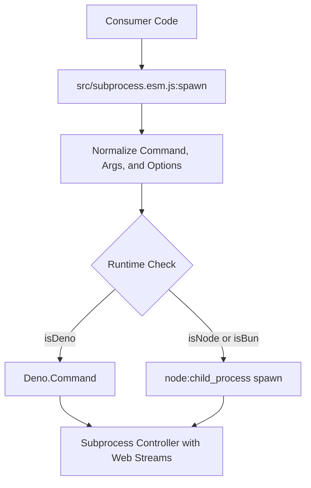

# Subprocess Module (`@extcompat/subprocess`) Documentation

The [`@extcompat/subprocess`](src/subprocess.esm.js:1) module provides unified cross-runtime subprocess execution with Web Streams and Promise-based status tracking across Deno, Node.js, Bun, and derivative JavaScript runtimes.

---

## Architecture & Design

### Modern Web Standards Alignment

[`src/subprocess.esm.js`](src/subprocess.esm.js:1) standardizes subprocess I/O around modern Web APIs:
- Process standard input (`stdin`) is modeled as a standard [`WritableStream`](src/subprocess.esm.js:203).
- Process standard output (`stdout`) and standard error (`stderr`) are modeled as standard [`ReadableStream`](src/subprocess.esm.js:203) instances.
- Process cancellation and termination support [`AbortSignal`](src/subprocess.esm.js:429).
- Resource disposal is supported via `Symbol.asyncDispose`.

### Dynamic Runtime Engine Routing

Calls are routed dynamically based on environment detection from [`@compat/runtime`](deno.json:7):
- **Deno** (`isDeno`): Utilizes native [`Deno.Command`](src/subprocess.esm.js:437) and Deno's native Web Stream subprocess engine.
- **Node.js & Bun** (`isNode`, `isBun`): Utilizes `node:child_process` and converts Node streams to Web Streams (`nodeStream.Readable.toWeb` / `nodeStream.Writable.toWeb`).



---

## Installation & Import

### CDN Distribution

```json
{
  "imports": {
    "@compat/subprocess": "https://cdn.jsdelivr.net/gh/bkatzung/extcompat@<semver>/src/subprocess.esm.js"
  }
}
```

### Local Workspace Import

```javascript
import { spawn, Subprocess } from './src/subprocess.esm.js';
```

---

## Usage Examples

### 1. Basic Command Execution & Output Helpers

```javascript
import { spawn } from '@compat/subprocess';

// Capture text output directly
const proc = spawn('echo', ['Hello, Subprocess!']);
const res = await proc.text();

console.log(res.stdout); // "Hello, Subprocess!\n"
console.log(res.code);   // 0
console.log(res.success);// true
```

### 2. JSON Output Parsing

```javascript
import { spawn } from '@compat/subprocess';

const proc = spawn('node', ['-e', 'console.log(JSON.stringify({ status: "ready", code: 200 }))']);
const res = await proc.json();

console.log(res.stdout.status); // "ready"
console.log(res.stdout.code);   // 200
```

### 3. Piping Standard Input

```javascript
import { spawn } from '@compat/subprocess';

// Option A: Pass string or Uint8Array directly in options
const proc = spawn('cat', { stdin: 'input data to pipe' });
const res = await proc.text();
console.log(res.stdout); // "input data to pipe"

// Option B: Stream into stdin via WritableStream
const proc2 = spawn('cat', { stdin: 'piped' });
const writer = proc2.stdin.getWriter();
await writer.write(new TextEncoder().encode('streaming chunk 1\n'));
await writer.write(new TextEncoder().encode('streaming chunk 2\n'));
await writer.close();

const res2 = await proc2.text();
console.log(res2.stdout);
```

### 4. Streaming Output Consumption

```javascript
import { spawn } from '@compat/subprocess';

const proc = spawn('git', ['log', '--oneline']);

for await (const chunk of proc.stdout) {
  console.log('Received chunk:', new TextDecoder().decode(chunk));
}

const status = await proc.status;
console.log('Process exited with code:', status.code);
```

### 5. Timeouts and AbortSignal

```javascript
import { spawn } from '@compat/subprocess';

const controller = new AbortController();
setTimeout(() => controller.abort(), 2000); // 2 second timeout

const proc = spawn('sleep', ['10'], { signal: controller.signal });
const status = await proc.status;
console.log('Process aborted:', status.success === false);
```

---

## Detailed API Specifications

### Functions

#### `spawn(command, argsOrOptions?, options?)`

Spawns a child process asynchronously across Bun, Deno, and Node.js.

- **Signatures**:
  - `spawn(command, options)`
  - `spawn(command, args, options)`
  - `spawn([command, ...args], options)`
- **Parameters**:
  - `command` (`string | URL | string[]`): Executable command name, path, file URL, or command array.
  - `argsOrOptions` (`string[] | object`, optional): Array of command line arguments or options object.
  - `options` (`object`, optional):
    - `args` (`string[]`): Command line arguments.
    - `cwd` (`string | URL`): Working directory for the subprocess. Supports file URLs.
    - `env` (`Record<string, string>`): Environment key-value pairs.
    - `clearEnv` (`boolean`): If `true`, resets parent environment variables (default `false`).
    - `stdin` (`'piped' | 'inherit' | 'null' | ReadableStream | Uint8Array | string`): Standard input behavior.
    - `stdout` (`'piped' | 'inherit' | 'null'`): Standard output behavior (default `'piped'`).
    - `stderr` (`'piped' | 'inherit' | 'null'`): Standard error behavior (default `'piped'`).
    - `signal` (`AbortSignal`): Abort signal to terminate the subprocess.
    - `uid` (`number`): POSIX user identifier.
    - `gid` (`number`): POSIX group identifier.
    - `windowsHide` (`boolean`): Hide console window on Windows (default `true`).
    - `detached` (`boolean`): Run detached from parent process (default `false`).
- **Returns**: `Subprocess`

---

## Classes

### `Subprocess`

Unified subprocess instance controlling the active child process.

#### Properties
- `pid`: `number` — Subprocess OS process ID.
- `stdin`: `WritableStream<Uint8Array> | null` — Writable Web Stream connected to child input (if piped).
- `stdout`: `ReadableStream<Uint8Array> | null` — Readable Web Stream connected to child output (if piped).
- `stderr`: `ReadableStream<Uint8Array> | null` — Readable Web Stream connected to child error output (if piped).
- `status`: `Promise<SubprocessStatus>` — Resolves with `{ success: boolean, code: number, signal: string | number | null }` when process exits.

#### Methods
- `output()`: `Promise<{ success: boolean, code: number, signal: string | number | null, stdout: Uint8Array, stderr: Uint8Array }>` — Collects all binary output.
- `text()`: `Promise<{ success: boolean, code: number, signal: string | number | null, stdout: string, stderr: string }>` — Collects output decoded as UTF-8 strings.
- `json()`: `Promise<{ success: boolean, code: number, signal: string | number | null, stdout: any, stderr: string }>` — Collects stdout parsed as JSON.
- `kill(signo?)`: `boolean` — Sends signal (`'SIGTERM'`, `'SIGKILL'`, etc.) to child process.
- `ref()`: `void` — Retains the subprocess in the event loop.
- `unref()`: `void` — Unreferences the subprocess so event loop can exit.
- `[Symbol.asyncDispose]()`: `Promise<void>` — Resource disposal hook.
